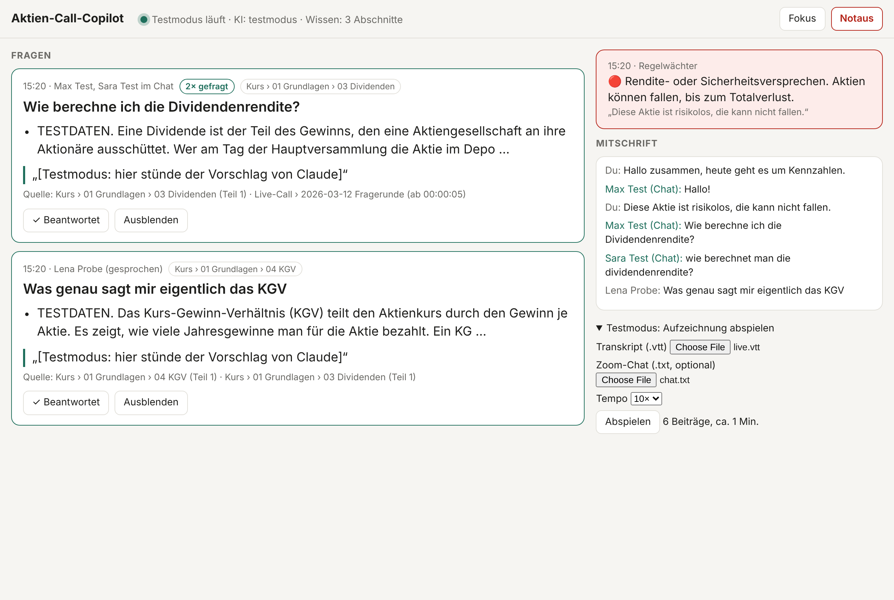

# Aktien-Call-Copilot

Live-Coach für Christians Aktien-Calls über Zoom. Zoom liefert die Mitschrift und den öffentlichen Chat über **RTMS (Realtime Media Streams)** an diesen Server. Der Server erkennt Fragen der Lernenden, sucht die passenden Stellen aus Emilias Videokurs und Live-Calls und lässt Claude einen Hinweis schreiben. Christian sieht die Hinweise auf dem zweiten Bildschirm.



```
Zoom-Meeting ─RTMS─► server/zoom-rtms.mjs ─► copilot.mjs ─► Frage? ─► wissen.mjs (Suche) ─► coach.mjs (Claude)
 (Transkript + Chat)                          │                                                    │
                                              └─ Regelwächter (Trainer)        Oberfläche ◄── SSE ─┘
```

## Was es kann

- **Fragen aus Sprache und Chat:** Gesprochene Teilstücke derselben Person werden zusammengefügt. Gleiche Fragen mehrerer Lernender erscheinen als eine Karte mit „2× gefragt“.
- **Hinweis je Frage:** bis zu vier Stichpunkte, ein Satz zum Vorlesen, eine Rückfrage, die Quelle (Kurs-Lektion oder Live-Call mit Zeit) und eine Warnung bei Anlageberatung, Steuern oder Hebelprodukten. Steht etwas nicht im Wissen, sagt die Karte das.
- **Regelwächter** für das, was Christian sagt: Renditeversprechen, Kaufempfehlungen, Kursziele (rot), Hebelprodukte und Steuer-Einzelfälle (gelb). Er arbeitet ohne KI und schlägt sofort an.
- **Fokus-Ansicht**, **Notaus** (stoppt alles und löscht alles) und **Testmodus**, der ein altes Transkript (.vtt) mit Chat (.txt) in 1×, 4× oder 10× abspielt.

## Datenschutz

- Gespeichert wird nichts. Mitschrift und Fragen liegen nur im Arbeitsspeicher; Notaus oder ein Neustart löschen sie.
- An Claude gehen nur die letzten rund 40 Zeilen als Text, mit Rollen statt Namen („Trainer“, „Teilnehmer:in“).
- Die Zoom-App bekommt nur die Scopes für **Transkript und Chat**, nicht für Ton oder Video.
- In der Wissensdatenbank werden die Lernenden aus Emilias Calls anonymisiert (`[Name]`, „Teilnehmer:in“).
- Vor dem echten Einsatz: Lernende zu Beginn des Calls informieren (Text rechtlich prüfen lassen), AV-Vertrag mit Anthropic abschließen, Zustimmung von Emilia und IDF zur Nutzung der Kurs- und Call-Inhalte einholen.

## Lokal starten

```bash
npm install
npm test
```

Testmodus ohne Claude:

```bash
node wissen/baue_index.mjs test/beispiel/roh wissen/index.json
COPILOT_MOCK=1 COACH_TOKEN=demo npm start
```

Dann `http://localhost:8765/#token=demo` öffnen und unter „Testmodus“ `test/beispiel/live.vtt` und `chat.txt` abspielen. Mit echtem Claude: `ANTHROPIC_API_KEY` setzen und `COPILOT_MOCK` weglassen. Alle Variablen stehen in `.env.beispiel`.

## Wissensdatenbank

Rohdaten kommen nach `wissen/roh/`. Der Ordner wird nie committet.

```
wissen/roh/kurs/<Modul>/<Lektion>.vtt|.txt|.md   Videokurs aus LearningSuite (Transkript oder Skript)
wissen/roh/calls/<Datum Titel>.vtt               Emilias Live-Calls (Zoom-Cloud-Transkripte)
```

```bash
TRAINERIN_NAMEN=Emilia node wissen/baue_index.mjs
```

Das erzeugt `wissen/index.json`. Optional fasst `wissen/kompendium.md` das Wissen nach Themen zusammen. Es wird als fester Teil der Anweisung an Claude mitgeschickt und zwischengespeichert. Noch offen sind der Download aus Zoom und LearningSuite und das Erzeugen des Kompendiums.

## Zoom einrichten (Admin)

1. **Developer Pack** mit Guthaben buchen (RTMS kostet pro Minute, siehe zoom.us/pricing/developer).
2. Im Marketplace eine **General App (user-managed)** anlegen:
   - Scopes: `meeting:read:meeting_transcript` und den RTMS-Chat-Scope, sonst keine Medien-Scopes.
   - Event-Abos: `meeting.rtms_started`, `meeting.rtms_stopped`.
   - Endpunkt: `https://<server>/zoom/webhook`.
   - Client ID, Client Secret und Secret Token als Umgebungsvariablen setzen.
3. In den Kontoeinstellungen erlauben, dass Apps Echtzeit-Meetinginhalte bekommen. Bei Christian unter Zoom Apps die App auf **Auto-Start** stellen.
4. Christians Zoom-Anzeigename muss `TRAINER_NAMEN` enthalten, sonst werden seine eigenen Sätze als Lernenden-Fragen behandelt.

## Betrieb

RTMS braucht eine dauerhaft offene WebSocket-Verbindung, deshalb läuft das als kleiner Node-Server (Node 20+), nicht als Netlify-Funktion. Er sollte in Frankfurt stehen (z. B. Render, Fly.io oder Hetzner), hinter HTTPS. Der Server bedient Webhook und Oberfläche zugleich. `GET /health` ist der Gesundheitscheck.

## Dateien

| Datei | Rolle |
|---|---|
| `server/index.mjs` | HTTP-Server: Webhook, SSE-Stream, API, Oberfläche |
| `server/zoom-rtms.mjs` | RTMS-Protokoll (Signaling, Media, Keep-alive, Neuverbindung) |
| `server/webhook.mjs` | Signaturprüfung und URL-Validierung der Zoom-Webhooks |
| `server/copilot.mjs` | Ablauf: Mitschrift, Fragen, Warteschlange, Karten |
| `server/fragen.mjs` | Fragen-Erkennung, Ähnlichkeit, Regelwächter |
| `server/coach.mjs` | **Anweisung an Claude** (`SYSTEM`) und Antwortformat (`Hinweis`) |
| `server/wissen.mjs` | Suche (BM25), VTT-Parser, Anonymisierung, Abschnitte |
| `server/simulator.mjs` | Testmodus: Aufzeichnung abspielen |
| `wissen/baue_index.mjs` | baut `wissen/index.json` aus den Rohdaten |
| `public/index.html` | Oberfläche für den zweiten Bildschirm |
